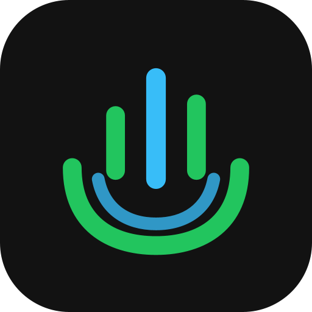
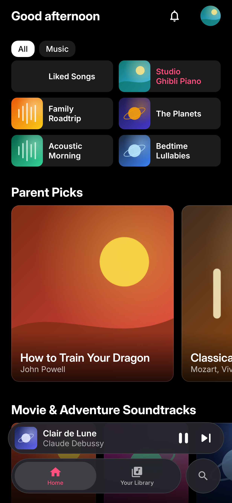
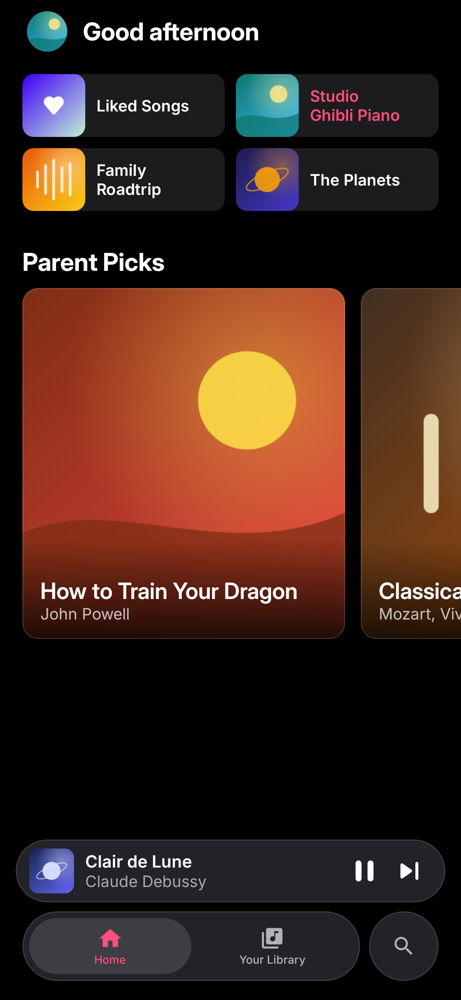
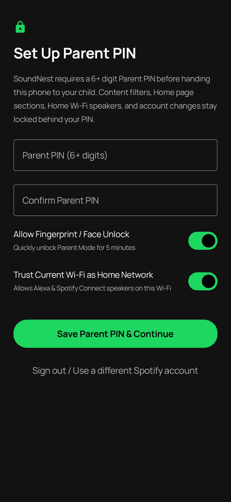
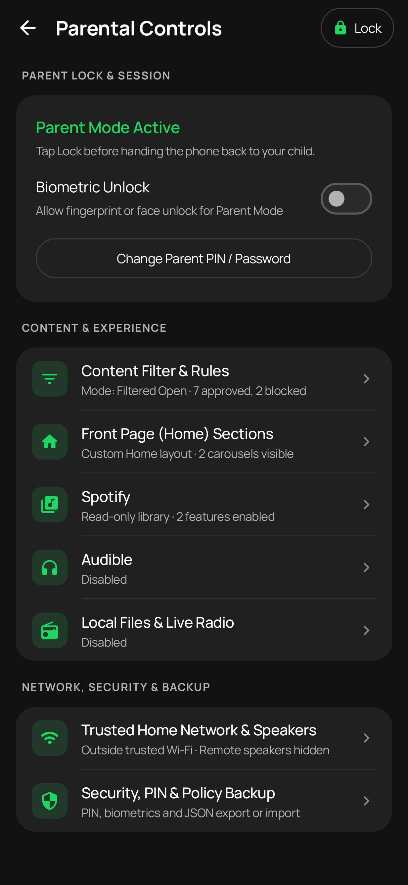
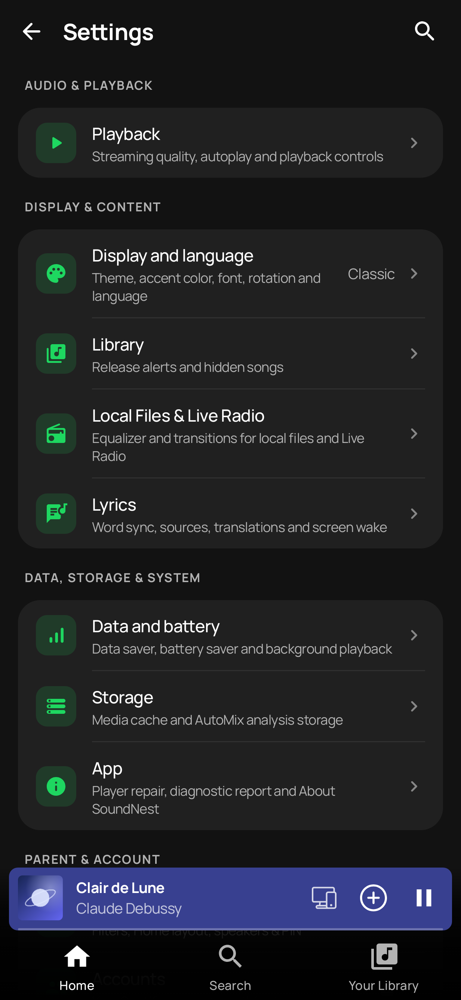
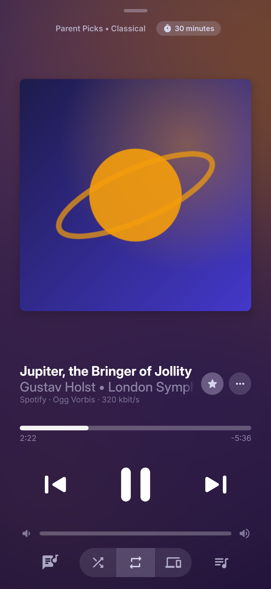

<div align="center">
  
  <h1>SoundNest</h1>
  <p><strong>A parent-controlled Android Spotify player built for children and teens (ages 9–16).</strong></p>
  <p>
    <a href="LICENSE"></a>
    
    
    
  </p>
</div>

---

**SoundNest** turns an Android phone or tablet into a calm, parent-curated music and audiobook player backed by a regular **Spotify Free** or **Spotify Premium** account — with optional parent-approved **Audible** audiobook streaming.

SoundNest is a focused **GPL-3.0** derivative of [Orpheon (formerly Myspoti)](https://github.com/kota-zo/Orpheon) that makes a deliberate philosophical and architectural split from upstream:

- **Zero ad-blocking or DRM circumvention** — no ad-muting, no WebView script injection to suppress ads, no SponsorBlock, no audio downloading/ripping (Audible streams in memory via standard Android `MediaDrm` Widevine with zero `.aax`/`.aaxc` decryption), and no Spotify attestation workarounds.
- **Zero third-party extensions or scrapers** — no extension runtime, no YouTube Music / external catalog scrapers, and no in-app self-updater bypassing device parental controls.
- **Zero unmoderated social or store surfaces** — Spotify Friend Activity, unmoderated user profiles, Music Videos, Canvas video loops, artist merch/concert prompts, and Audible Store / Plus catalog browsing are completely absent.
- **Fail-closed parental guardrails** — mandatory Parent PIN or password (4+ characters) on first launch, hybrid Blocklist / Strict Allowlist filtering, explicit per-book Audible Parent Picker, customizable Home shelves, Trusted Home Wi-Fi speaker boundaries, and a built-in Sleep Timer.

---

## Screenshots

| Immersive Home (`Parent Picks`) | Minimal Home Mode | Parent PIN Setup Gate |
| :---: | :---: | :---: |
|  |  |  |

| Parental Controls Dashboard | Kid-Accessible Settings | Immersive Player & Sleep Timer |
| :---: | :---: | :---: |
|  |  |  |

> All screenshots above are generated deterministically during automated testing via `./gradlew :app:generateDocScreenshots`.

---

## Spotify Free vs. Spotify Premium

SoundNest supports **both** Spotify Free and Spotify Premium accounts without requiring developer API keys:

| Capability | Spotify Free | Spotify Premium |
| :--- | :--- | :--- |
| **Account Sign-In** | Supported | Supported |
| **Advertisements** | Plays Spotify's standard audio ads unmodified via Spotify's official Web Player | Ad-free |
| **Playback Engine** | Official Web Player (`WebPlayerHost`) | Native Media3 Engine (`NativeAudio`, 10-band Equalizer, AutoMix beat-matched transitions) or Web Player |
| **Parental Content Filtering** | Full UI filtering + live playback guardrail (automatically skips or pauses if server-shuffle picks an explicit/disallowed song, while letting Spotify ads finish normally) | Full UI filtering + on-demand queue filtering + live playback guardrail |
| **Sleep Timer** | Supported (gradual fade-out & pause) | Supported (local & remote Connect speakers) |
| **Local Speakers (Chromecast)** | Supported on Home LAN | Supported on Home LAN |
| **Spotify Connect / Alexa Speakers** | Requires Spotify Premium (per Spotify's platform rules) | Supported on Parent-Trusted Home Wi-Fi |

---

## Parent Guide

### 1. First-Run Setup & Parent Lock Security
1. Install **SoundNest** and sign in with the Spotify Free or Premium account your child will use.
2. Immediately after sign-in, SoundNest blocks access to the app until you set a **Parent PIN or password (4+ characters)** (`Set Up Parent PIN or Password` — digits, letters, symbols, or passphrases are all supported).
3. Your PIN or password is hashed with **PBKDF2-HMAC-SHA256** (65,536 iterations) and wrapped in an **Android Keystore AES-GCM** hardware-backed key, with persistent exponential cooldowns after repeated wrong guesses (30s up to 15m).
4. Optionally enable **Fingerprint / Face Unlock** to enter Parent Mode quickly, and toggle **Trust Current Wi-Fi as Home Network** while at home.
5. Unlocking Parent Mode starts a **5-minute Admin Session** that automatically re-locks (or tap **Lock & Exit** before handing the device back to your child). Account switching, sign-out, hidden-song management, and diagnostic exports all require your Parent PIN or password.

### 2. Choosing a Content Filter Mode
Open **Settings -> Open Parental Controls Dashboard** to pick between two modes:

- **Filtered Open (Default — great for older kids & teens)**
  - Allows general music browsing and search while automatically hiding and blocking anything marked **Explicit** by Spotify (configurable), plus any artists, albums, playlists, tracks, title keywords, or regular expressions you block.
- **Strict Allowlist (Great for younger listeners)**
  - Blocks all playback and browsing **except** playlists, albums, artists, shows, and tracks you have explicitly approved.
  - Automatically disables open-ended discovery vectors such as Autoplay, Smart Shuffle, Track/Artist Radio, Playlist Extender, and Browse Category trees.

**Quick Allow / Block Actions:**
- While Parent Mode is unlocked, long-press or open the `...` menu on any track, album, artist, or playlist to approve or block it on the spot.
- Or paste any `spotify:...` URI or `https://open.spotify.com/...` URL directly into **Quick Allow / Block by Spotify Link or URI** in the Parental Controls Dashboard.

### 3. Customizing the Home Screen
Under **Home Screen & Shelves** in the Parental Controls Dashboard:
- **Parent Picks Shelf**: Automatically pins parent-approved Spotify playlists, albums, and artists — plus any pinned Audible audiobooks when **Show Pinned Audible Books on Home** is enabled — prominently at the top of Home.
- **Minimal Home Mode**: Strips the Home tab down to approved shortcuts and the **Parent Picks** shelf — zero algorithmic recommendations.
- **Granular Shelf Toggles**: Independently hide **Charts & Trending**, **Made For You & Mixes**, **New Releases & What's New Bell**, **Recently Played**, **Filter Chips**, **Pinned Audible Books on Home**, or the **AI DJ** card. You can also hide individual shelves by title/URI.

### 4. Feature Gates, Audible Audiobooks & Library Lock
Every non-music or external-content surface defaults to **off** until enabled by a parent:
- **Podcasts** & **Audiobooks** (off by default)
- **Audible as a Second Audiobook Source** (configured in **Parental Controls Dashboard -> Feature Access & Library Protection**; see [`docs/api/AUDIBLE.md`](docs/api/AUDIBLE.md)):
  - **Marketplace Auto-Default & Override**: Automatically selects your regional Audible marketplace from your device locale (`audible.de`, `audible.com`, `audible.co.uk`, `audible.fr`, `audible.ca`, `audible.com.au`, `audible.it`, `audible.es`, `audible.co.jp`, `audible.in`, `audible.com.br`), with manual override before sign-in.
  - **Ephemeral Login & Hardware-Backed Tokens**: Signs in via OAuth 2.0 + PKCE inside an isolated ephemeral WebView profile that is wiped immediately after capturing the authorization code (no persistent Amazon shopping cookies), storing device tokens encrypted with Android Keystore `AES-GCM`.
  - **Explicit Parent Picker (Fail-Closed)**: Syncs only your owned `GET /1.0/library` catalog — zero Audible Store or Plus catalog browsing. Every Audible book remains hidden in **both** *Filtered Open* and *Strict Allowlist* modes until explicitly approved in **Manage Approved Audible Books**.
  - **Separate Home Pinning**: Approving a book makes it available in **Your Library -> Audiobooks** and Search; pinning a book to **Parent Picks** on Home is controlled separately per book alongside the **Show Pinned Audible Books on Home** shelf toggle.
  - **Widevine Streaming & Local-Only Progress**: Streams chapters natively via Jetpack Media3 + Android `MediaDrm` (Widevine) and stores listening progress strictly on-device so the parent's own Audible / WhisperSync positions are never overwritten.
- **Live Radio** & **Local Device Audio Files** (off by default; storage audio permission is never requested unless Local Files is enabled)
- **Spotify Jam** (off by default, and restricted to Trusted Home Wi-Fi when enabled)
- **Lyrics**: Time-synced lyrics are enabled by default; **Genius Song Meanings** and **Third-Party Community Lyric Sources** (`LRCLIB` / `NetEase`) default to **off**.
- **Read-Only Spotify Library**: Prevents children from deleting playlists, unliking songs, or modifying saved albums unless Parent Mode is unlocked.

### 5. `open.spotify.com` Deep-Link Filtering & Google Family Link
- Any `spotify:...` or `https://open.spotify.com/...` link opened from messaging apps or browsers is intercepted by `SpotifyLinkGuard` and checked against your active `ParentalPolicy` before opening or playing.
- **Recommended Companion Setup**: Pair SoundNest with **Google Family Link** (or your device MDM) to manage app installation permissions, screen-time schedules, and system browser restrictions. SoundNest intentionally omits any self-updater so OS-level parental controls remain authoritative.

### 6. Trusted Home Wi-Fi, Speakers & Sleep Timer
- **Trusted Home Wi-Fi**: Cloud Spotify Connect and Amazon Alexa speakers are hidden when your child is on mobile data or an untrusted Wi-Fi network, preventing accidental playback on speakers at home while away (or on unfamiliar networks).
- **Custom Speaker Names & Visibility**: Rename speakers (e.g., *"Emma's Bedroom Echo"*) and choose between *Allow All Except Hidden* or *Only Allowed Speakers*.
- **Sleep Timer**: Available directly to kids from the player controls without needing the Parent PIN — fades volume down gently and pauses both local playback and active remote speakers.

### 7. Copying Rules to Sibling Devices (`soundnest-policy.json`)
In **Parental Controls Dashboard -> Backup & Sibling Sync**, tap **Export Policy JSON** to save your allowlists (including approved and Home-pinned Audible ASINs), blocklists, keywords, Home section settings, feature gates, and speaker labels to `soundnest-policy.json`, then tap **Import Policy JSON** on another child's device. (Parent PINs and account credentials are never exported in backup files.)

---

## Building, Testing & Regenerating Screenshots

### Prerequisites
- **JDK 17+** (JDK 21 recommended)
- **Android SDK** (`compileSdk = 37`, `minSdk = 29`) configured via `ANDROID_HOME` or `base/local.properties` (`sdk.dir=/path/to/Android/Sdk`)

### Build Debug APK
```bash
cd base
./gradlew assembleDebug
```
The debug APK (`io.github.thake.soundnest.dev`, labeled **SoundNest dev**) installs alongside release builds with isolated storage.

### Run Automated Unit Tests
All 9 Gradle modules (`:api`, `:api-audible`, `:api-spotify`, `:automix`, `:engine`, `:engine-android`, `:host-android`, `:host-cdp`, `:app`) include fast JVM / Robolectric unit tests:
```bash
cd base
./gradlew :api:test :api-audible:test :api-spotify:test :automix:test :engine:jvmTest \
          :engine-android:testDebugUnitTest :host-android:testDebugUnitTest \
          :host-cdp:test :app:testDebugUnitTest
```

### Regenerate Documentation Screenshots
Documentation screenshots in [`docs/screenshots/`](docs/screenshots/) are rendered headlessly with **Roborazzi + Robolectric Native Graphics** and are skipped during normal `:app:testDebugUnitTest` runs so unit tests stay fast. To regenerate them on demand:
```bash
cd base
./gradlew :app:generateDocScreenshots
```

---

## License & Upstream Attribution

**SoundNest** (`https://github.com/thake/soundnest`) is free and open-source software licensed under the **GNU General Public License v3.0** — see [LICENSE](LICENSE).

SoundNest is a derivative fork built upon the work of the following open-source projects:

- **[Orpheon (formerly Myspoti)](https://github.com/kota-zo/Orpheon)** (`https://github.com/kota-zo/myspoti`) by `kota-zo` and contributors — **GPL-3.0**. Core Spotify Web Player bridge, GraphQL/Pathfinder client (`:api-spotify`), native playback engine (`:engine`), AutoMix transition planner (`:automix`), Chromecast sender, and adaptive Compose shell.
- **[BitChord](https://github.com/kushagrasinghx/BitChord)** by the BitChord contributors — **GPL-3.0-or-later**. Immersive look components, mesh gradients, swept lyrics, Liquid Glass chrome, and equalizer DSP processor.
- **[Spotui](https://github.com/Spotui/Spotui)** — **GPL-3.0**. Classic look UI foundations.

See [THIRD_PARTY_NOTICES.md](THIRD_PARTY_NOTICES.md) for full component-level attribution and compatible third-party licenses (`Beat This!`, `ONNX Runtime`, `Backdrop`, `Haze`, `Reorderable`, `Inter`, and Chromium `cast_channel.proto`).

*Spotify is a trademark of Spotify AB. Audible is a trademark of Audible, Inc. SoundNest is an independent open-source project and is not affiliated with, endorsed by, or sponsored by Spotify AB or Audible, Inc.*
