# SoundNest Complete Screen Catalog

Auto-generated deterministically by `./gradlew :app:generateDocScreenshots` ([`DocScreenshotTest.kt`](../../base/app/src/test/java/io/github/thake/soundnest/ui/DocScreenshotTest.kt)).

Total captured screens, panels, dialogs & sheets: **130**.

## Contents
- [Hero Overview (6)](#hero-overview)
- [Onboarding & Session (9)](#onboarding-session)
- [Parental Controls & Security (17)](#parental-controls-security)
- [Classic Look (40)](#classic-look)
- [Immersive Look (46)](#immersive-look)
- [Sheets & Modals (12)](#sheets-modals)

## Hero Overview

| Screen | Preview | File & Description |
| :--- | :---: | :--- |
| **Immersive Home (Filtered Open)** (`IMMERSIVE`) | 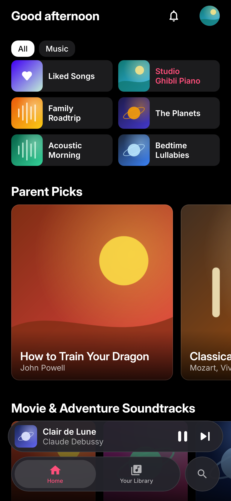 | [`immersive-home.png`](immersive-home.png) Curated shelves, Parent Picks, and floating glass mini-player. |
| **Minimal Home (Strict Allowlist)** (`IMMERSIVE`) |  | [`minimal-home.png`](minimal-home.png) Distraction-free home showing only parent-approved playlists and albums. |
| **Mandatory Parent PIN Gate** (`CLASSIC`) | 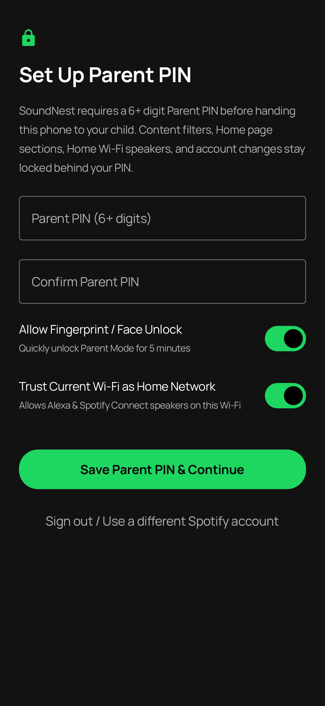 | [`parent-pin-gate.png`](parent-pin-gate.png) Post-login security gate supporting a 4+ character PIN or password. |
| **Parental Controls Dashboard** (`CLASSIC`) | 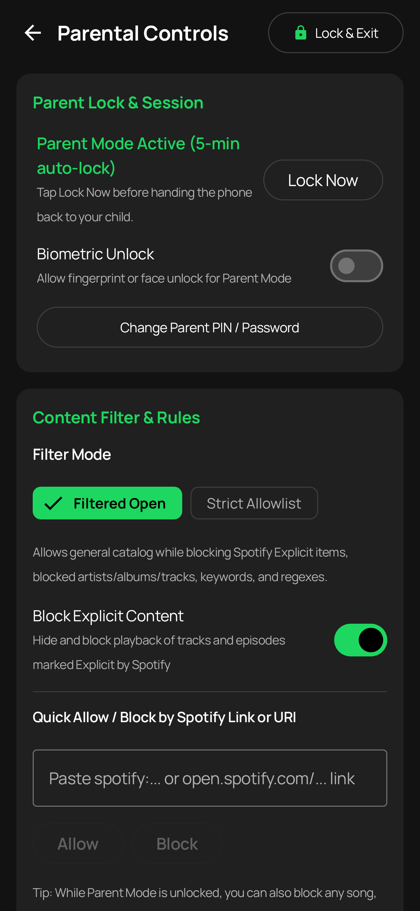 | [`parent-dashboard.png`](parent-dashboard.png) PIN-locked configuration for filter modes, allowlists, and feature gates. |
| **Kid-Accessible Settings** (`CLASSIC`) | 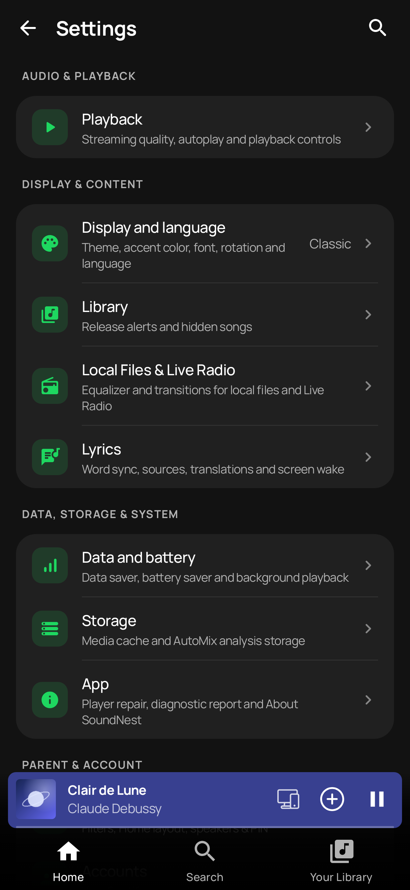 | [`kid-settings.png`](kid-settings.png) Audio, appearance, and compact Parent Controls header icon. |
| **Immersive Full-Screen Player** (`IMMERSIVE`) | 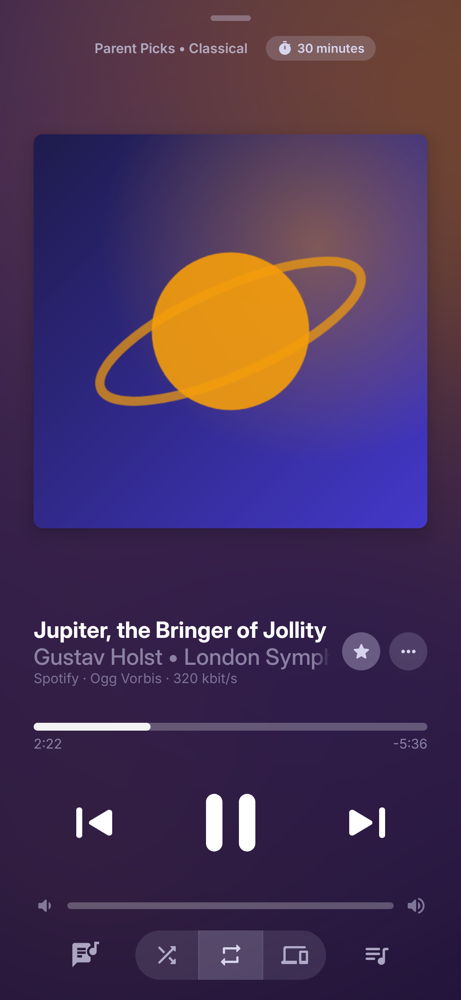 | [`immersive-player.png`](immersive-player.png) Full-screen artwork mesh backdrop, scrubber, sleep timer, and transport controls. |

## Onboarding & Session

| Screen | Preview | File & Description |
| :--- | :---: | :--- |
| **Welcome Screen** (`CLASSIC`) | 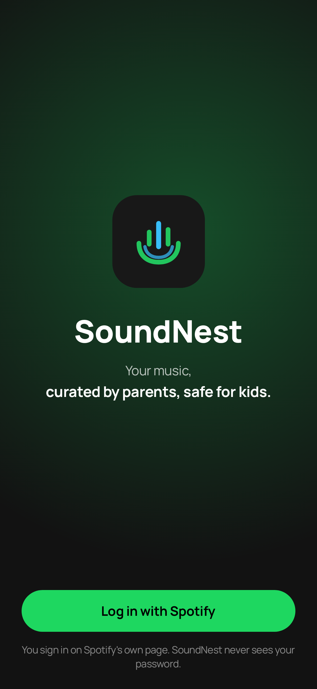 | [`onboarding/01-welcome.png`](onboarding/01-welcome.png) First-launch landing screen before Spotify login. |
| **Sign-In Help Dialog** (`CLASSIC`) | 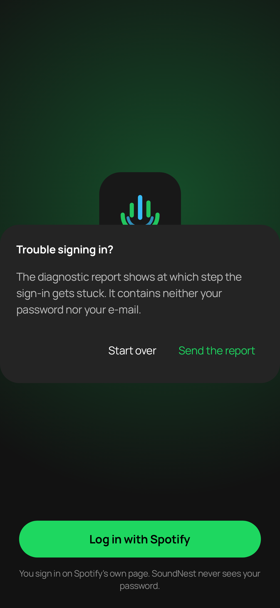 | [`onboarding/02-login-help-dialog.png`](onboarding/02-login-help-dialog.png) Troubleshooting modal explaining Spotify WebView sign-in options. |
| **Connecting Session** (`CLASSIC`) |  | [`onboarding/03-connecting.png`](onboarding/03-connecting.png) Startup loading screen while verifying the Spotify WebPlayer session. |
| **Connection Problem** (`CLASSIC`) | 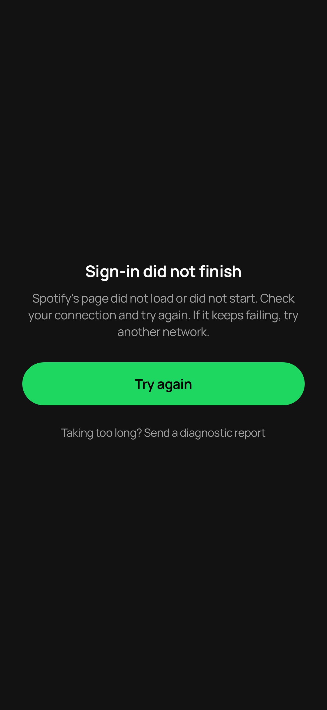 | [`onboarding/04-login-problem.png`](onboarding/04-login-problem.png) Offline or session verification failure screen with retry action. |
| **Setup Step 1: Intro** (`CLASSIC`) | 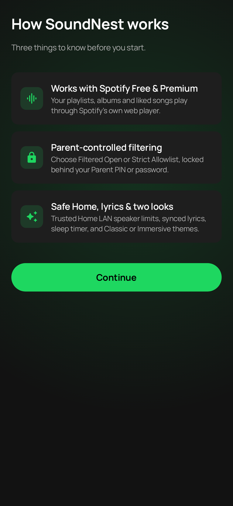 | [`onboarding/05-setup-intro.png`](onboarding/05-setup-intro.png) Initial onboarding welcome step after Spotify sign-in. |
| **Setup Step 2: Look (Classic)** (`CLASSIC`) | 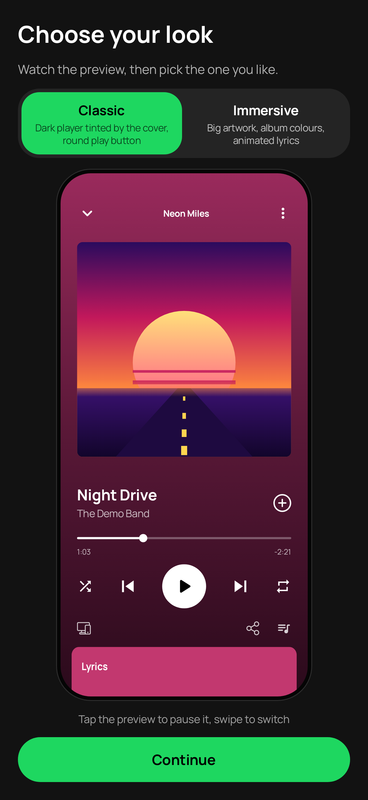 | [`onboarding/06-setup-look-classic.png`](onboarding/06-setup-look-classic.png) Live look chooser previewing the Classic dark layout. |
| **Setup Step 2: Look (Immersive)** (`IMMERSIVE`) | 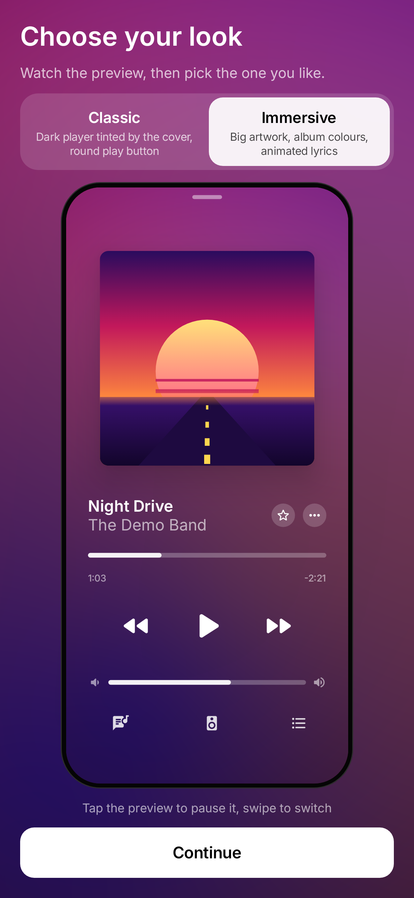 | [`onboarding/07-setup-look-immersive.png`](onboarding/07-setup-look-immersive.png) Live look chooser previewing the Immersive mesh-glass layout. |
| **Setup Step 3: Audio Quality** (`CLASSIC`) | 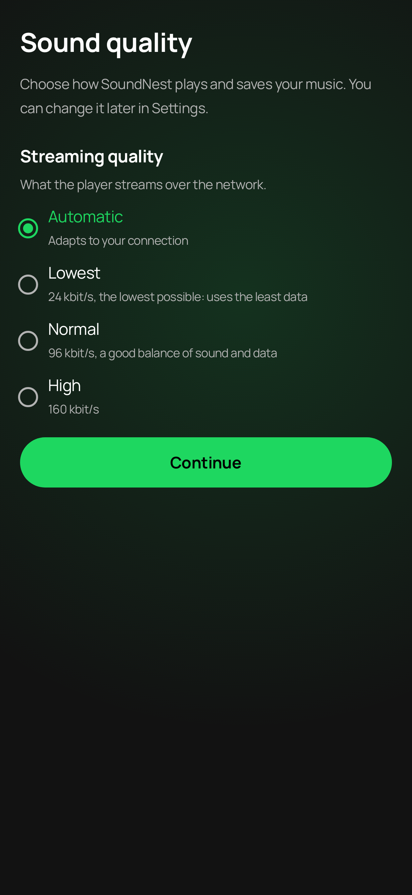 | [`onboarding/08-setup-quality.png`](onboarding/08-setup-quality.png) Streaming quality selection for Wi-Fi and mobile data. |
| **Setup Step 4: Permissions** (`CLASSIC`) | 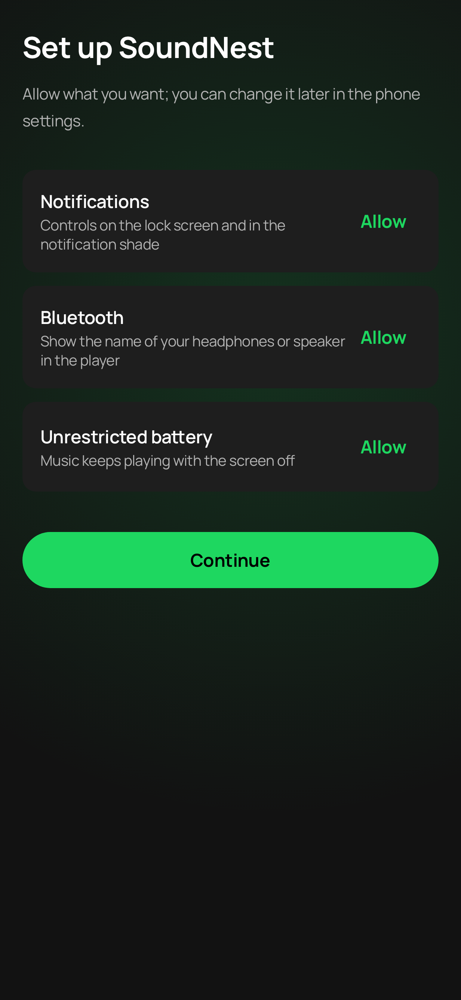 | [`onboarding/09-setup-permissions.png`](onboarding/09-setup-permissions.png) Notification & background playback permission prompt step. |

## Parental Controls & Security

| Screen | Preview | File & Description |
| :--- | :---: | :--- |
| **Initial Parent PIN / Password Setup** (`CLASSIC`) | 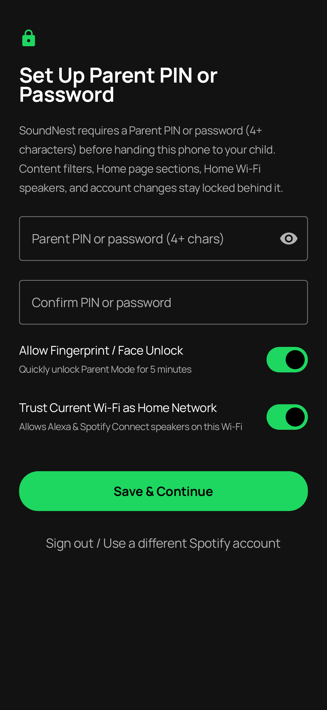 | [`parental/01-pin-setup.png`](parental/01-pin-setup.png) Mandatory setup screen with 4+ character PIN or password and zero-permission Home LAN trust option. |
| **Parent Unlock Prompt** (`CLASSIC`) | 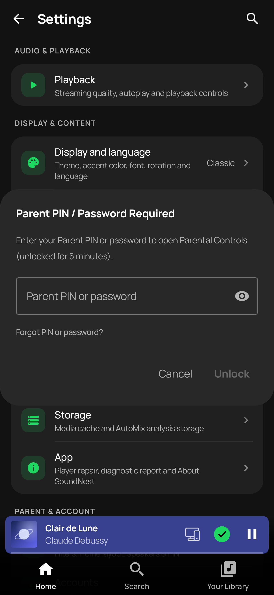 | [`parental/02-pin-unlock-prompt.png`](parental/02-pin-unlock-prompt.png) Modal PIN/password prompt with Forgot PIN recovery guidance. |
| **Brute-Force Cooldown Lockout** (`CLASSIC`) | 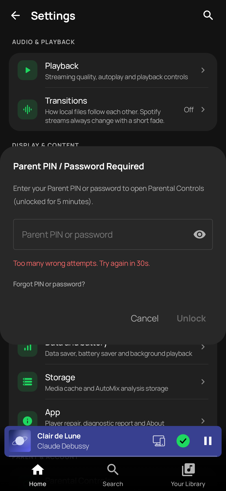 | [`parental/03-pin-unlock-lockout.png`](parental/03-pin-unlock-lockout.png) Exponential backoff lockout state after 5 failed PIN attempts. |
| **Change Parent PIN / Password Dialog** (`CLASSIC`) | 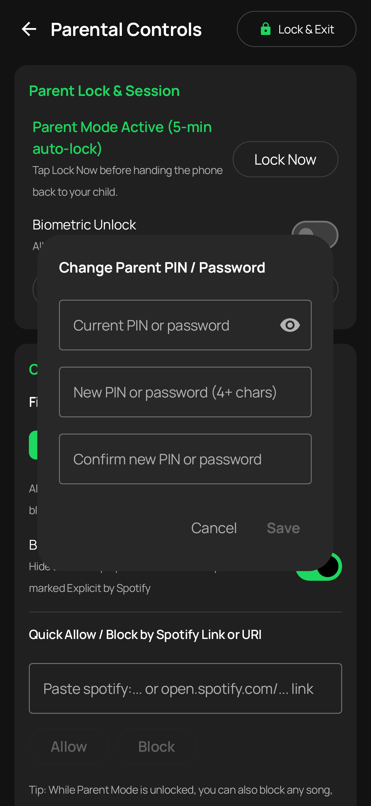 | [`parental/04-change-pin-dialog.png`](parental/04-change-pin-dialog.png) Modal dialog to update the current parent PIN or password. |
| **Dashboard: Security & Filter Mode** (`CLASSIC`) |  | [`parental/05-dashboard-top.png`](parental/05-dashboard-top.png) Admin session status, PIN change, Filter Mode selector, and explicit/keyword rules. |
| **Dashboard: Content Allowlists & Rule Counts** (`CLASSIC`) | 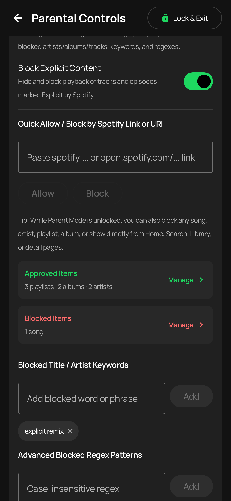 | [`parental/06-dashboard-allowlists.png`](parental/06-dashboard-allowlists.png) Approved playlists, albums, artists, and summary rule manager rows. |
| **Dashboard: Home Customization** (`CLASSIC`) | 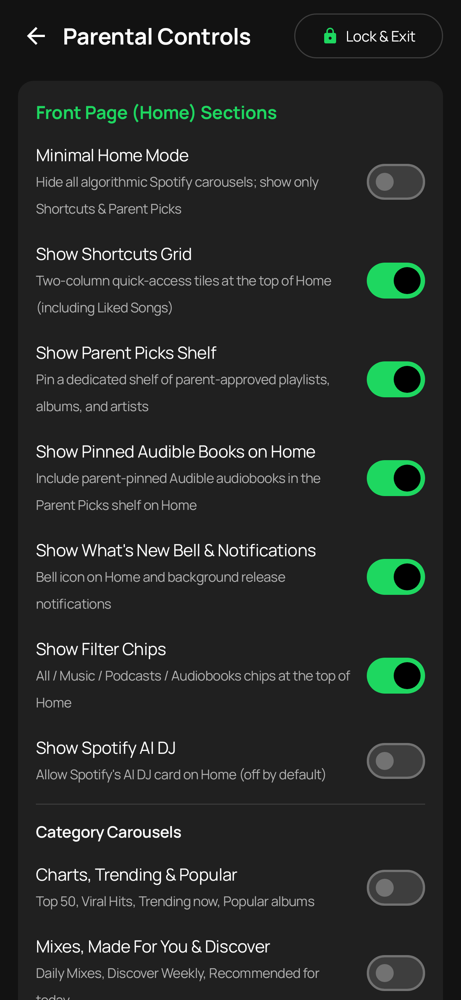 | [`parental/07-dashboard-home-sections.png`](parental/07-dashboard-home-sections.png) Minimal Home mode, Parent Picks shelf, and shelf visibility toggles. |
| **Dashboard: Feature Gates** (`CLASSIC`) | 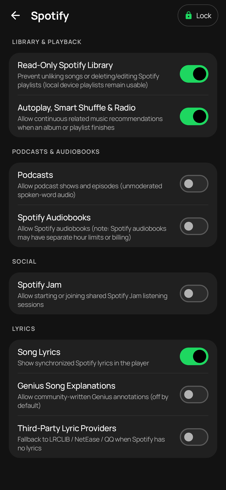 | [`parental/08-dashboard-feature-gates.png`](parental/08-dashboard-feature-gates.png) Granular switches for podcasts, audiobooks, lyrics, radio, local files, and library edits. |
| **Dashboard: Speakers & Trusted Home LAN** (`CLASSIC`) | 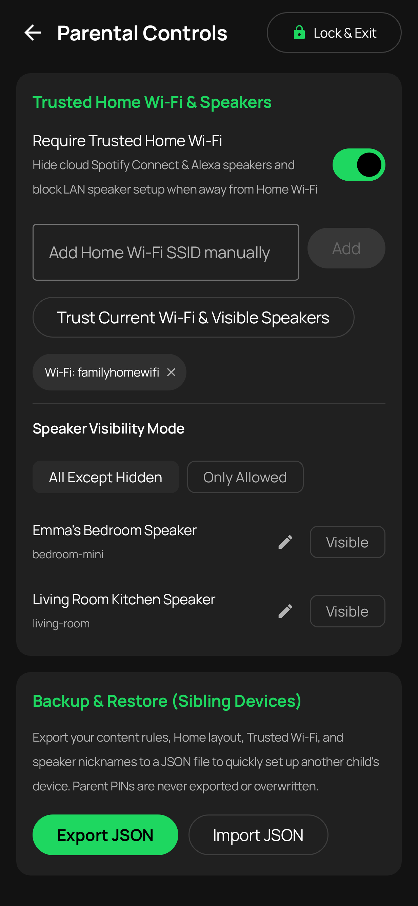 | [`parental/09-dashboard-speakers-network.png`](parental/09-dashboard-speakers-network.png) Zero-permission Home LAN & mDNS speaker fingerprints and Spotify Connect visibility rules. |
| **Dashboard: Encrypted Config Backup** (`CLASSIC`) | 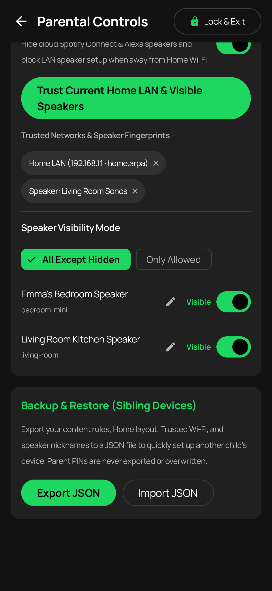 | [`parental/10-dashboard-backup-restore.png`](parental/10-dashboard-backup-restore.png) Passphrase-encrypted parental policy export and import. |
| **Settings (Admin Session Active)** (`CLASSIC`) | 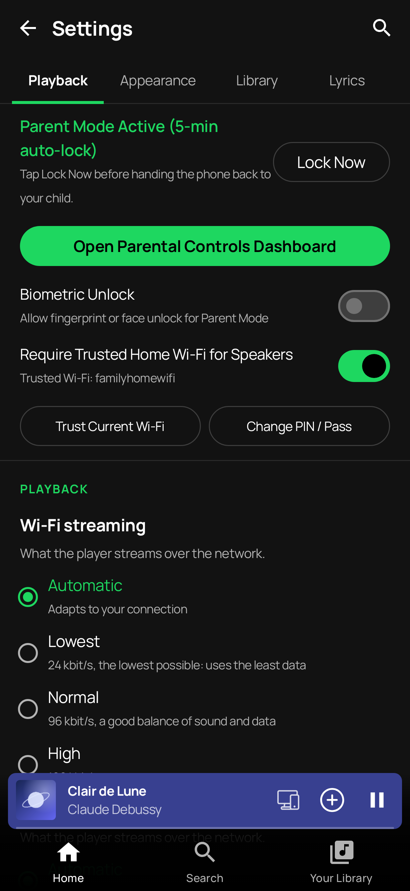 | [`parental/11-settings-admin-unlocked.png`](parental/11-settings-admin-unlocked.png) Floating global Parent Mode banner while the 5-minute Admin Session is unlocked. |
| **Manage Content Rules Sheet** (`CLASSIC`) | 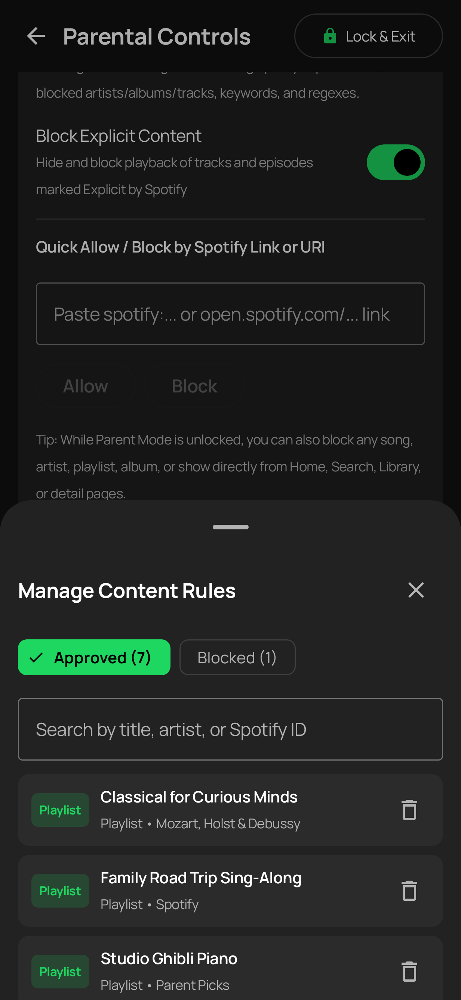 | [`parental/12-manage-content-rules-sheet.png`](parental/12-manage-content-rules-sheet.png) Searchable Approved & Blocked item rules manager with human-readable titles. |
| **Dashboard: Audible Audiobooks** (`CLASSIC`) | 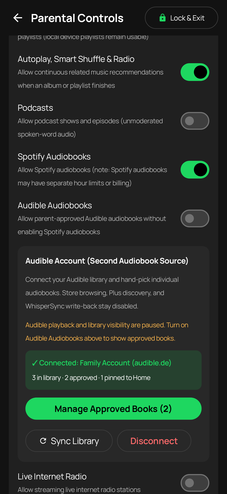 | [`parental/13-audible-account-controls.png`](parental/13-audible-account-controls.png) Connected Audible marketplace status, library sync, and approved/pinned book counts. |
| **Audible Parent Picker Sheet** (`CLASSIC`) | 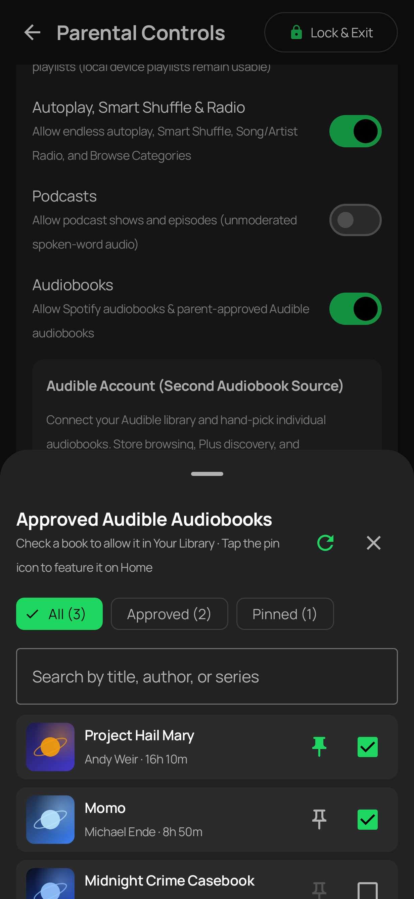 | [`parental/14-audible-parent-picker-sheet.png`](parental/14-audible-parent-picker-sheet.png) Explicit per-book Approve and separate Pin to Home controls over the parent's owned Audible library. |
| **In-App Blocking: Playlist Header Pill** (`IMMERSIVE`) | 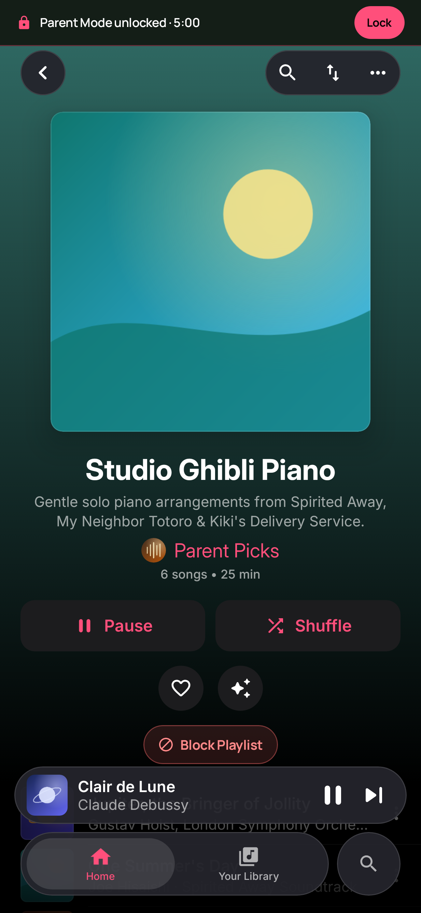 | [`parental/15-playlist-inline-block-pill.png`](parental/15-playlist-inline-block-pill.png) 1-tap Block Playlist pill and floating Parent Mode banner directly on a regular playlist detail page (zero Spotify URIs needed). |
| **In-App Blocking: Song Options Menu** (`IMMERSIVE`) | 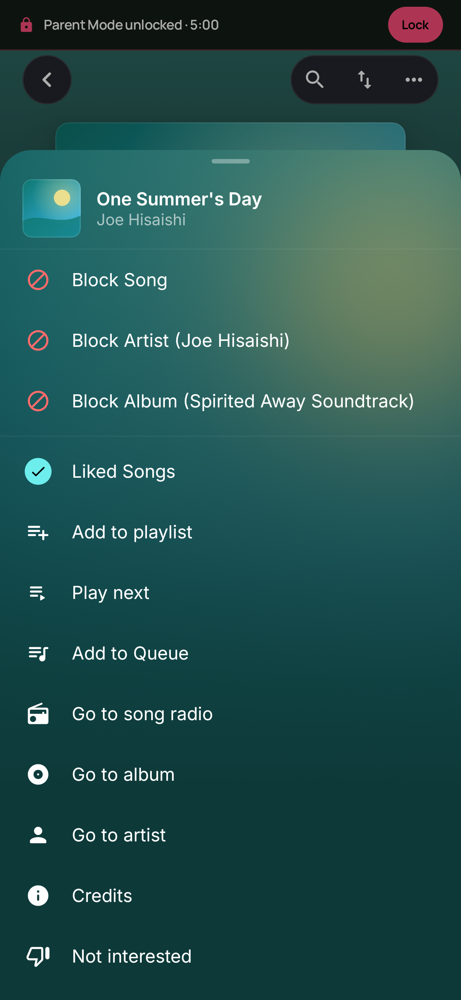 | [`parental/16-song-options-parent-block.png`](parental/16-song-options-parent-block.png) Song context menu while Parent Mode is unlocked, exposing 1-tap Block Song, Block Artist, and Block Album actions. |
| **In-App Blocking: Home Card Quick-Block Sheet** (`IMMERSIVE`) | 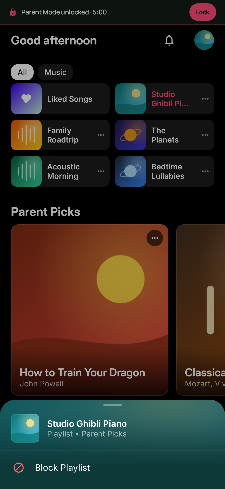 | [`parental/17-quick-block-sheet.png`](parental/17-quick-block-sheet.png) Home card overflow buttons and 1-tap ParentQuickBlockSheet while Parent Mode is unlocked. |

## Classic Look

| Screen | Preview | File & Description |
| :--- | :---: | :--- |
| **Home (Filtered Open)** (`CLASSIC`) | 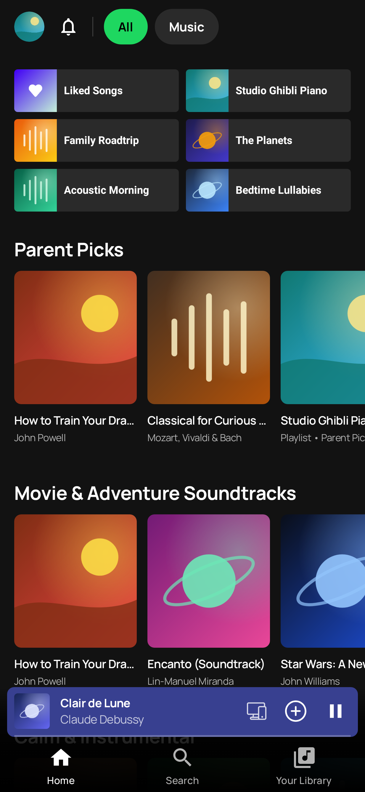 | [`classic/01-home-filtered-open.png`](classic/01-home-filtered-open.png) Classic Home with filter chips, shortcuts, and family-friendly shelves. |
| **Home (Strict Minimal)** (`CLASSIC`) | 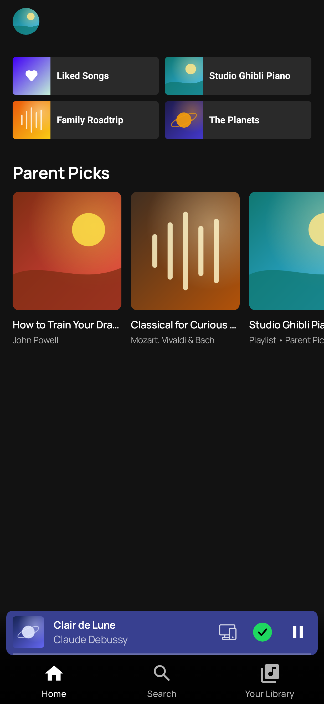 | [`classic/02-home-strict-minimal.png`](classic/02-home-strict-minimal.png) Classic Home in Strict Allowlist + Minimal Home mode. |
| **Search (Browse Categories)** (`CLASSIC`) | 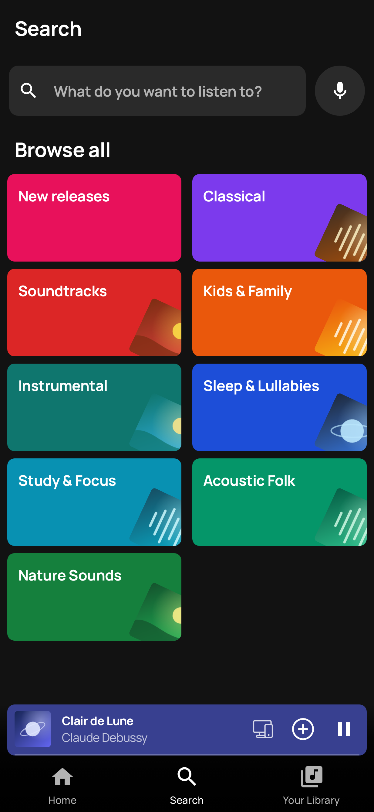 | [`classic/03-search-browse-idle.png`](classic/03-search-browse-idle.png) Classic Search idle state displaying Spotify genre browse cards. |
| **Search (Results)** (`CLASSIC`) | 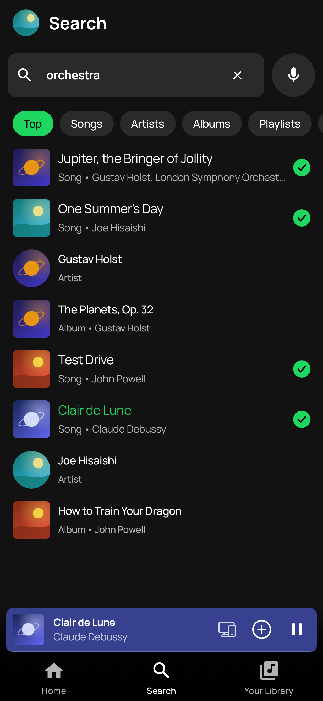 | [`classic/04-search-results.png`](classic/04-search-results.png) Classic Search with query, filter chips, and mixed track/artist/album hits. |
| **Library (List View)** (`CLASSIC`) | 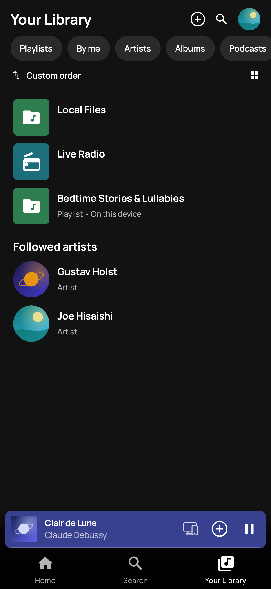 | [`classic/05-library-list.png`](classic/05-library-list.png) Classic Your Library in list mode with playlists, albums, and artists. |
| **Library (Grid View)** (`CLASSIC`) | 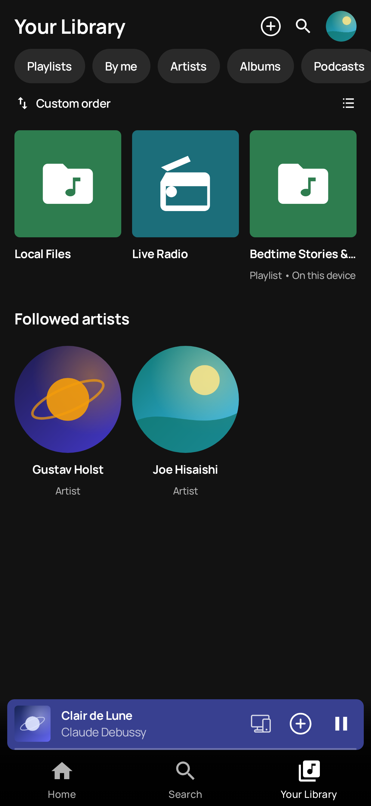 | [`classic/06-library-grid.png`](classic/06-library-grid.png) Classic Your Library in cover grid mode. |
| **Playlist Detail** (`CLASSIC`) | 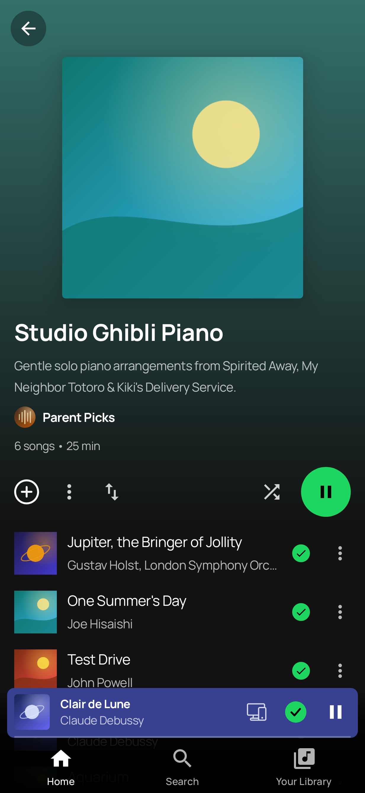 | [`classic/07-playlist-detail.png`](classic/07-playlist-detail.png) Classic Playlist screen with cover header, play/shuffle controls, and tracks. |
| **Album Detail** (`CLASSIC`) | 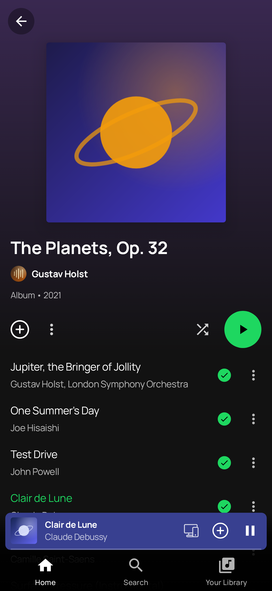 | [`classic/08-album-detail.png`](classic/08-album-detail.png) Classic Album screen with release metadata, tracklist, and copyright footer. |
| **Liked Songs** (`CLASSIC`) | 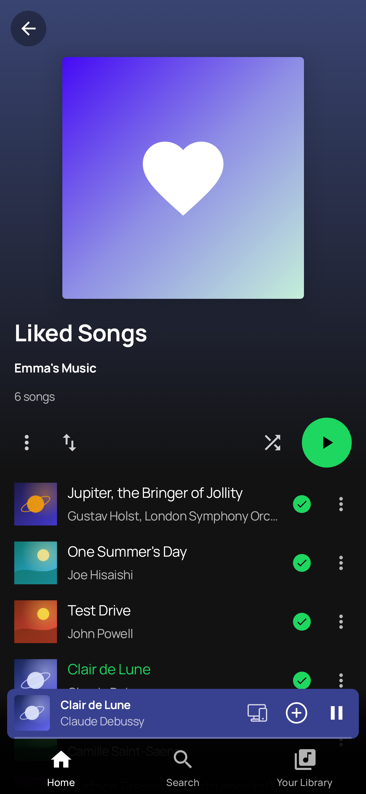 | [`classic/09-liked-songs.png`](classic/09-liked-songs.png) Classic Liked Songs collection view. |
| **Artist Overview** (`CLASSIC`) | 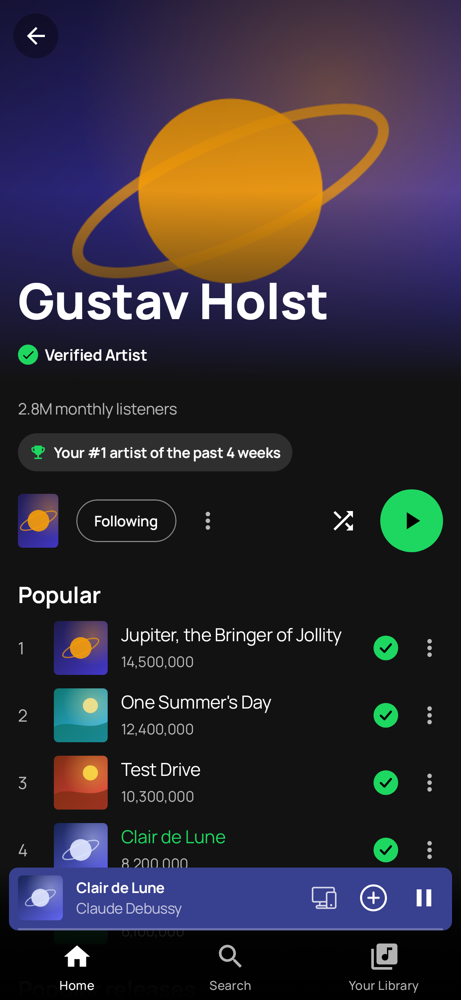 | [`classic/10-artist-overview.png`](classic/10-artist-overview.png) Classic Artist page with monthly listeners, top tracks, releases, and related artists. |
| **Artist Discography** (`CLASSIC`) | 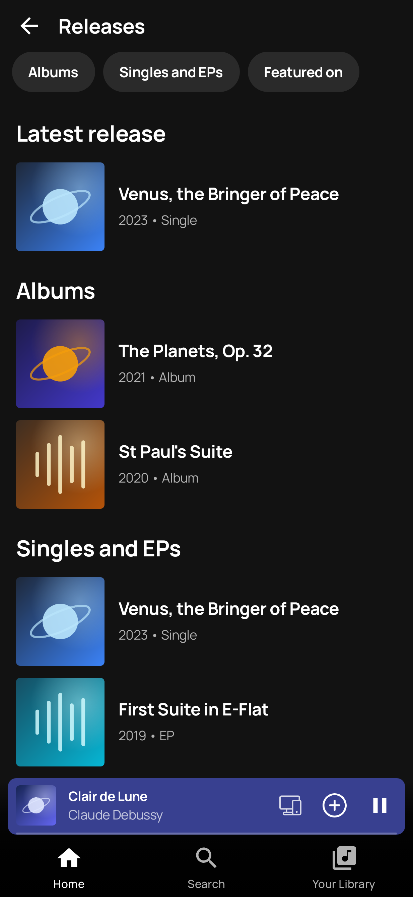 | [`classic/11-artist-releases.png`](classic/11-artist-releases.png) Classic Artist Releases screen with spotlight and Album/Single filter chips. |
| **Genre / Category Browse** (`CLASSIC`) | 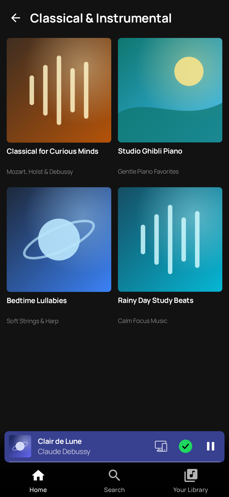 | [`classic/12-category-browse.png`](classic/12-category-browse.png) Classic Category playlist grid. |
| **Podcast Show** (`CLASSIC`) | 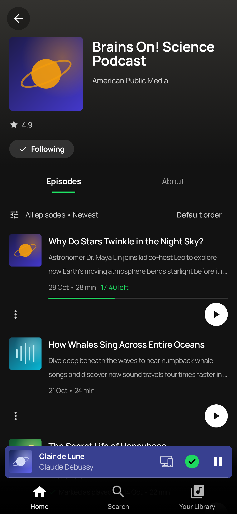 | [`classic/13-podcast-show.png`](classic/13-podcast-show.png) Classic Podcast Show page with episode progress bars and filter. |
| **Audiobook Detail** (`CLASSIC`) | 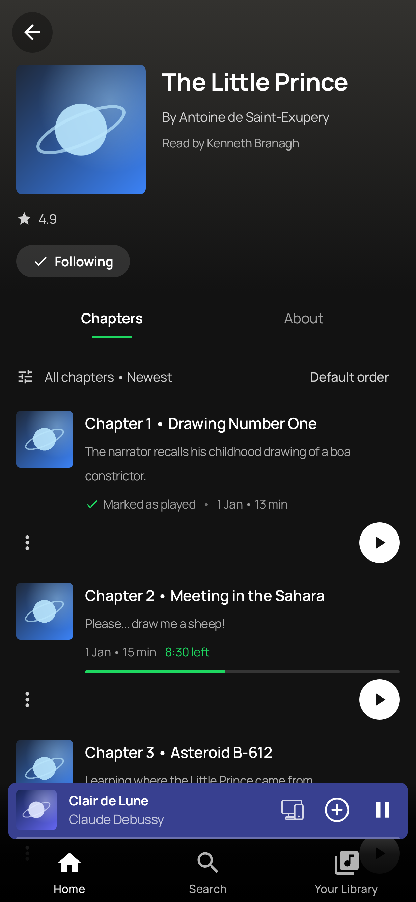 | [`classic/14-audiobook-detail.png`](classic/14-audiobook-detail.png) Classic Audiobook page with author/narrator byline and chapters. |
| **Podcast Episode Detail** (`CLASSIC`) | 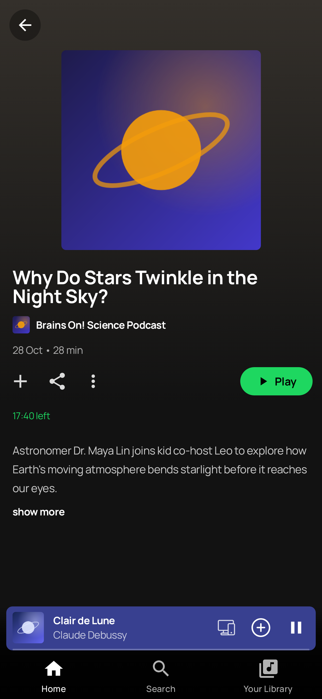 | [`classic/15-podcast-episode.png`](classic/15-podcast-episode.png) Classic single Episode page with show link, progress, and description. |
| **Your Episodes** (`CLASSIC`) | 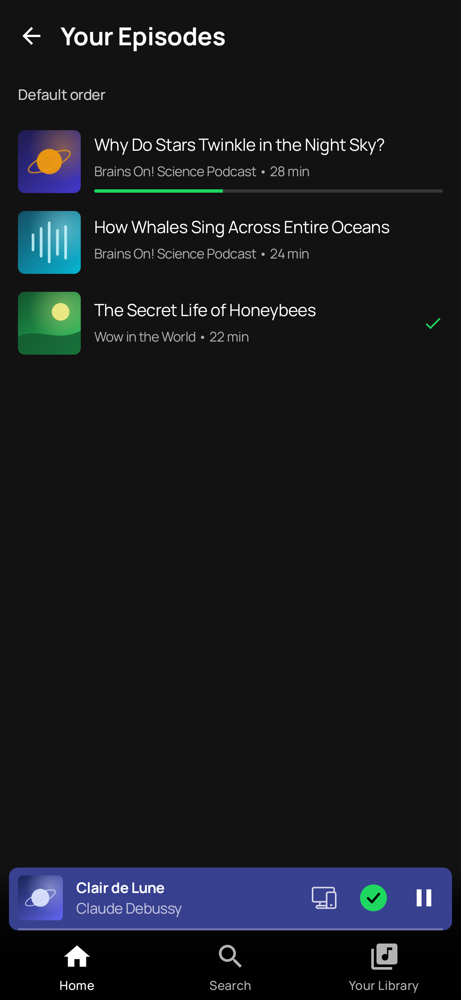 | [`classic/16-your-episodes.png`](classic/16-your-episodes.png) Classic saved podcast episodes list. |
| **New Episodes** (`CLASSIC`) | 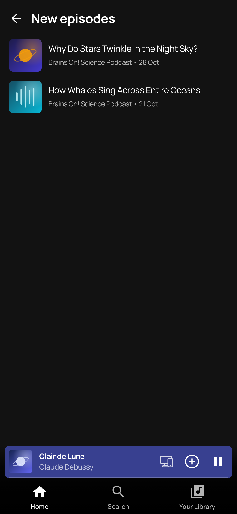 | [`classic/17-new-episodes.png`](classic/17-new-episodes.png) Classic unplayed episodes from followed shows. |
| **What's New Feed** (`CLASSIC`) | 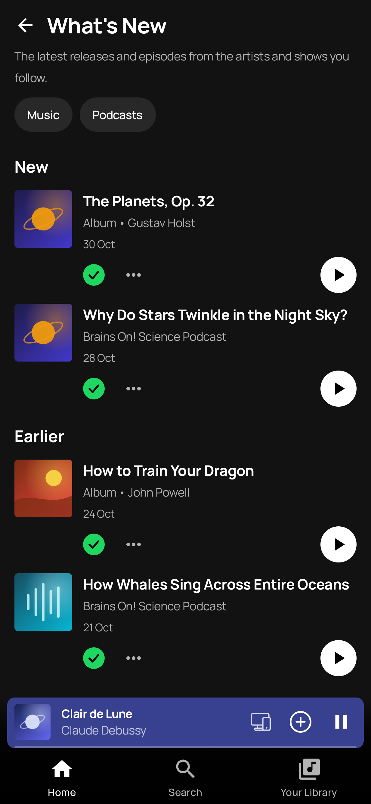 | [`classic/18-whats-new.png`](classic/18-whats-new.png) Classic What's New feed with New and Earlier sections. |
| **New Releases Grid** (`CLASSIC`) | 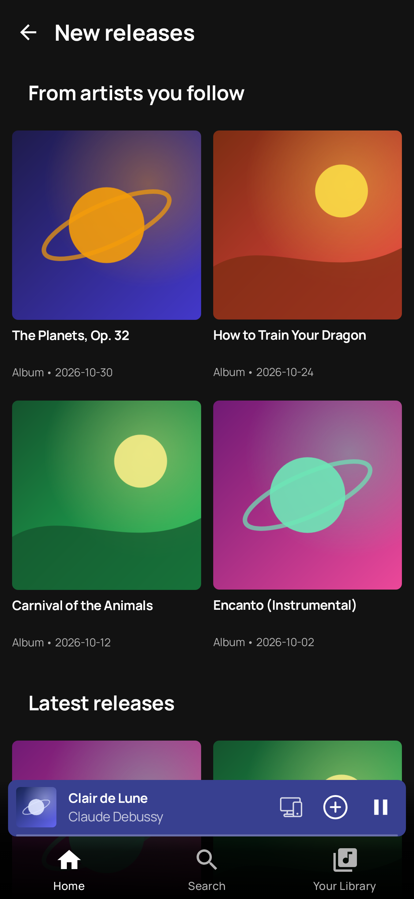 | [`classic/19-new-releases.png`](classic/19-new-releases.png) Classic New Releases grid from followed artists. |
| **Recently Played** (`CLASSIC`) | 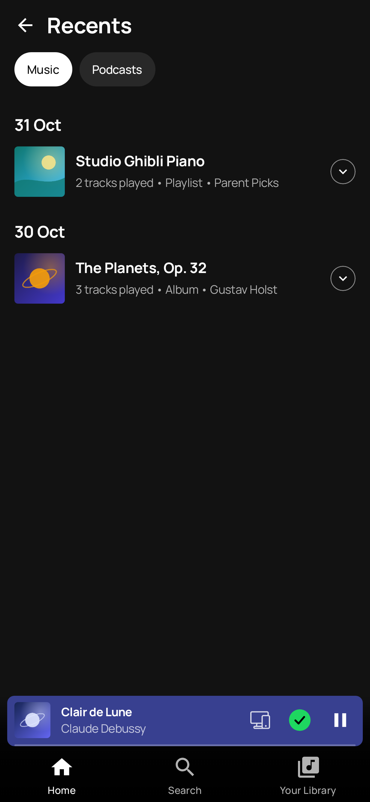 | [`classic/20-recently-played.png`](classic/20-recently-played.png) Classic account play history grouped by context and day. |
| **Listening Stats (Spotify Tab)** (`CLASSIC`) | 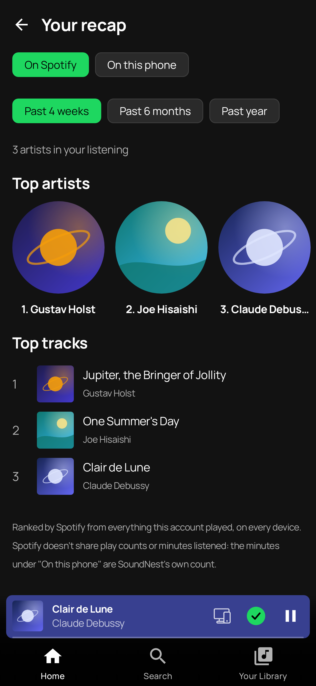 | [`classic/21-recap-spotify-stats.png`](classic/21-recap-spotify-stats.png) Classic Listening Stats showing account top tracks and artists. |
| **Listening Stats (This Phone Tab)** (`CLASSIC`) |  | [`classic/22-recap-phone-stats.png`](classic/22-recap-phone-stats.png) Classic on-device listening minutes, weekly chart, and top tracks. |
| **Library Folder** (`CLASSIC`) |  | [`classic/23-library-folder.png`](classic/23-library-folder.png) Classic Spotify library folder view. |
| **Local Files** (`CLASSIC`) |  | [`classic/24-local-files.png`](classic/24-local-files.png) Classic Local Files screen prompting for on-device audio access. |
| **Local Playlist** (`CLASSIC`) |  | [`classic/25-local-playlist.png`](classic/25-local-playlist.png) Classic on-device playlist screen. |
| **Live Radio** (`CLASSIC`) |  | [`classic/26-live-radio.png`](classic/26-live-radio.png) Classic Live Radio screen with favorite stations and search. |
| **Hidden Songs** (`CLASSIC`) |  | [`classic/27-hidden-songs.png`](classic/27-hidden-songs.png) Classic PIN-protected Hidden Songs list. |
| **Equalizer & Audio Effects** (`CLASSIC`) |  | [`classic/28-equalizer.png`](classic/28-equalizer.png) Classic 5-band equalizer, presets, playback speed, and silence skip. |
| **Full-Screen Music Player** (`CLASSIC`) |  | [`classic/29-player-music.png`](classic/29-player-music.png) Classic full-screen music player with inline lyrics card below. |
| **Full-Screen Podcast Player** (`CLASSIC`) |  | [`classic/30-player-podcast.png`](classic/30-player-podcast.png) Classic podcast player with 15s skip controls, speed, and sleep timer. |
| **Full-Screen Synced Lyrics** (`CLASSIC`) |  | [`classic/31-lyrics-fullscreen.png`](classic/31-lyrics-fullscreen.png) Classic full-screen time-synced lyrics view. |
| **Play Queue** (`CLASSIC`) |  | [`classic/32-queue.png`](classic/32-queue.png) Classic Queue screen with Now Playing, Next in Queue, and Next Up. |
| **Settings: Playback** (`CLASSIC`) |  | [`classic/33-settings-playback.png`](classic/33-settings-playback.png) Classic Settings Playback tab with streaming quality, autoplay, and transitions. |
| **Settings: Transitions & AutoMix** (`CLASSIC`) |  | [`classic/34-settings-transitions.png`](classic/34-settings-transitions.png) Classic Settings Transitions sub-page (crossfade & AutoMix). |
| **Settings: Lyrics** (`CLASSIC`) |  | [`classic/35-settings-lyrics.png`](classic/35-settings-lyrics.png) Classic Settings Lyrics tab. |
| **Settings: Storage & Data** (`CLASSIC`) |  | [`classic/36-settings-storage.png`](classic/36-settings-storage.png) Classic Settings Storage tab (image/audio caches & data saver). |
| **Settings: Appearance** (`CLASSIC`) |  | [`classic/37-settings-appearance.png`](classic/37-settings-appearance.png) Classic Settings Appearance tab (Look, AMOLED theme, language). |
| **Settings: About** (`CLASSIC`) |  | [`classic/38-settings-about.png`](classic/38-settings-about.png) Classic Settings About tab (version, diagnostics, credits). |
| **Settings: Accounts (PIN-Unlocked)** (`CLASSIC`) |  | [`classic/39-settings-accounts.png`](classic/39-settings-accounts.png) Classic Settings Accounts tab after parent PIN unlock. |
| **Settings: Library** (`CLASSIC`) |  | [`classic/40-settings-library.png`](classic/40-settings-library.png) Classic Settings Library tab. |

## Immersive Look

| Screen | Preview | File & Description |
| :--- | :---: | :--- |
| **Home (Filtered Open)** (`IMMERSIVE`) |  | [`immersive/01-home-filtered-open.png`](immersive/01-home-filtered-open.png) Immersive Home with glass pills, shortcuts, and curated shelves. |
| **Home (Strict Minimal)** (`IMMERSIVE`) |  | [`immersive/02-home-strict-minimal.png`](immersive/02-home-strict-minimal.png) Immersive Home in Strict Allowlist + Minimal Home mode. |
| **Search (Browse Categories)** (`IMMERSIVE`) |  | [`immersive/03-search-browse-idle.png`](immersive/03-search-browse-idle.png) Immersive Search idle state with large title and genre cards. |
| **Search (Results)** (`IMMERSIVE`) |  | [`immersive/04-search-results.png`](immersive/04-search-results.png) Immersive Search with glass filter pills and mixed hits. |
| **Library (List View)** (`IMMERSIVE`) |  | [`immersive/05-library-list.png`](immersive/05-library-list.png) Immersive Library list with filter pills and floating glass chrome. |
| **Library (Grid View)** (`IMMERSIVE`) |  | [`immersive/06-library-grid.png`](immersive/06-library-grid.png) Immersive Library cover grid view. |
| **Playlist Detail** (`IMMERSIVE`) |  | [`immersive/07-playlist-detail.png`](immersive/07-playlist-detail.png) Immersive Playlist page with artwork glow and glass action buttons. |
| **Album Detail** (`IMMERSIVE`) |  | [`immersive/08-album-detail.png`](immersive/08-album-detail.png) Immersive Album page with centered cover art, metadata, and numbered tracks. |
| **Liked Songs** (`IMMERSIVE`) |  | [`immersive/09-liked-songs.png`](immersive/09-liked-songs.png) Immersive Liked Songs collection view. |
| **Artist Overview** (`IMMERSIVE`) |  | [`immersive/10-artist-overview.png`](immersive/10-artist-overview.png) Immersive Artist page with full-bleed hero header, top tracks, and releases. |
| **Artist Discography** (`IMMERSIVE`) |  | [`immersive/11-artist-releases.png`](immersive/11-artist-releases.png) Immersive Artist Releases screen. |
| **Genre / Category Browse** (`IMMERSIVE`) |  | [`immersive/12-category-browse.png`](immersive/12-category-browse.png) Immersive Category playlist grid. |
| **Podcast Show** (`IMMERSIVE`) |  | [`immersive/13-podcast-show.png`](immersive/13-podcast-show.png) Immersive Podcast Show page with cover glow and episode rows. |
| **Audiobook Detail** (`IMMERSIVE`) |  | [`immersive/14-audiobook-detail.png`](immersive/14-audiobook-detail.png) Immersive Audiobook page with chapters and narrator metadata. |
| **Podcast Episode Detail** (`IMMERSIVE`) |  | [`immersive/15-podcast-episode.png`](immersive/15-podcast-episode.png) Immersive single Episode detail page. |
| **Your Episodes** (`IMMERSIVE`) |  | [`immersive/16-your-episodes.png`](immersive/16-your-episodes.png) Immersive saved podcast episodes screen. |
| **New Episodes** (`IMMERSIVE`) |  | [`immersive/17-new-episodes.png`](immersive/17-new-episodes.png) Immersive unplayed episodes from followed shows. |
| **What's New Feed** (`IMMERSIVE`) |  | [`immersive/18-whats-new.png`](immersive/18-whats-new.png) Immersive What's New feed. |
| **New Releases Grid** (`IMMERSIVE`) |  | [`immersive/19-new-releases.png`](immersive/19-new-releases.png) Immersive New Releases grid. |
| **Recently Played** (`IMMERSIVE`) |  | [`immersive/20-recently-played.png`](immersive/20-recently-played.png) Immersive Recently Played screen with expandable context groups. |
| **Listening Stats (Spotify Tab)** (`IMMERSIVE`) |  | [`immersive/21-recap-spotify-stats.png`](immersive/21-recap-spotify-stats.png) Immersive Listening Stats with segmented control on Spotify rankings. |
| **Listening Stats (This Phone Tab)** (`IMMERSIVE`) |  | [`immersive/22-recap-phone-stats.png`](immersive/22-recap-phone-stats.png) Immersive on-device listening stats and weekly bar chart. |
| **Library Folder** (`IMMERSIVE`) |  | [`immersive/23-library-folder.png`](immersive/23-library-folder.png) Immersive Spotify library folder screen. |
| **Local Files** (`IMMERSIVE`) |  | [`immersive/24-local-files.png`](immersive/24-local-files.png) Immersive Local Files permission screen. |
| **Local Playlist** (`IMMERSIVE`) |  | [`immersive/25-local-playlist.png`](immersive/25-local-playlist.png) Immersive on-device playlist screen. |
| **Live Radio** (`IMMERSIVE`) |  | [`immersive/26-live-radio.png`](immersive/26-live-radio.png) Immersive Live Radio station browser and favorites. |
| **Hidden Songs** (`IMMERSIVE`) |  | [`immersive/27-hidden-songs.png`](immersive/27-hidden-songs.png) Immersive PIN-protected Hidden Songs screen. |
| **Equalizer & Audio Effects** (`IMMERSIVE`) |  | [`immersive/28-equalizer.png`](immersive/28-equalizer.png) Immersive inset-grouped Equalizer & playback effects screen. |
| **Full-Screen Music Player** (`IMMERSIVE`) |  | [`immersive/29-player-music.png`](immersive/29-player-music.png) Immersive music player with dynamic artwork mesh backdrop. |
| **Player: Synced Lyrics Panel** (`IMMERSIVE`) |  | [`immersive/30-player-lyrics-panel.png`](immersive/30-player-lyrics-panel.png) Immersive player with inline swept karaoke/synced lyrics panel open. |
| **Player: Queue Panel** (`IMMERSIVE`) |  | [`immersive/31-player-queue-panel.png`](immersive/31-player-queue-panel.png) Immersive player with reorderable Up Next queue panel open. |
| **Full-Screen Podcast Player** (`IMMERSIVE`) |  | [`immersive/32-player-podcast.png`](immersive/32-player-podcast.png) Immersive podcast player with 15s skip controls and speed pill. |
| **Standalone Queue Page** (`IMMERSIVE`) |  | [`immersive/33-queue-page.png`](immersive/33-queue-page.png) Immersive standalone Queue route. |
| **Settings: Root Categories** (`IMMERSIVE`) |  | [`immersive/34-settings-root.png`](immersive/34-settings-root.png) Immersive Settings root with inset groups and Parental Controls card. |
| **Settings: Playback** (`IMMERSIVE`) |  | [`immersive/35-settings-playback.png`](immersive/35-settings-playback.png) Immersive Settings Playback sub-page. |
| **Settings: Wi-Fi Streaming Quality** (`IMMERSIVE`) |  | [`immersive/36-settings-streaming-wifi.png`](immersive/36-settings-streaming-wifi.png) Immersive Settings Wi-Fi quality picker page. |
| **Settings: Crossfade & AutoMix** (`IMMERSIVE`) |  | [`immersive/37-settings-crossfade.png`](immersive/37-settings-crossfade.png) Immersive Settings Crossfade and AutoMix transitions page. |
| **Settings: Lyrics** (`IMMERSIVE`) |  | [`immersive/38-settings-lyrics.png`](immersive/38-settings-lyrics.png) Immersive Settings Lyrics sub-page. |
| **Settings: Storage** (`IMMERSIVE`) |  | [`immersive/39-settings-storage.png`](immersive/39-settings-storage.png) Immersive Settings Storage & cache usage sub-page. |
| **Settings: Data Saver** (`IMMERSIVE`) |  | [`immersive/40-settings-data.png`](immersive/40-settings-data.png) Immersive Settings Data Saver & cellular quality sub-page. |
| **Settings: Display & Appearance** (`IMMERSIVE`) |  | [`immersive/41-settings-display.png`](immersive/41-settings-display.png) Immersive Settings Display sub-page. |
| **Settings: Look Chooser** (`IMMERSIVE`) |  | [`immersive/42-settings-look.png`](immersive/42-settings-look.png) Immersive Settings Classic vs Immersive look switcher. |
| **Settings: App Language** (`IMMERSIVE`) |  | [`immersive/43-settings-language.png`](immersive/43-settings-language.png) Immersive Settings Language picker. |
| **Settings: Library** (`IMMERSIVE`) |  | [`immersive/44-settings-library.png`](immersive/44-settings-library.png) Immersive Settings Library preferences sub-page. |
| **Settings: Accounts (PIN-Unlocked)** (`IMMERSIVE`) |  | [`immersive/45-settings-accounts.png`](immersive/45-settings-accounts.png) Immersive Settings Spotify Accounts sub-page. |
| **Settings: About SoundNest** (`IMMERSIVE`) |  | [`immersive/46-settings-app-about.png`](immersive/46-settings-app-about.png) Immersive Settings App version, diagnostics, and credits sub-page. |

## Sheets & Modals

| Screen | Preview | File & Description |
| :--- | :---: | :--- |
| **Classic Song Options Sheet** (`CLASSIC`) |  | [`sheets/01-classic-song-options.png`](sheets/01-classic-song-options.png) Track context menu in Classic look (read-only library aware). |
| **Immersive Song Options Sheet** (`IMMERSIVE`) |  | [`sheets/02-immersive-song-options.png`](sheets/02-immersive-song-options.png) Glass track context menu over the Immersive player. |
| **Spotify Connect & Cast Devices Sheet** (`IMMERSIVE`) |  | [`sheets/03-devices-connect-sheet.png`](sheets/03-devices-connect-sheet.png) Speaker & device switcher filtered by Parental Speaker Visibility rules. |
| **Classic Sleep Timer Sheet** (`CLASSIC`) |  | [`sheets/04-classic-sleep-timer-sheet.png`](sheets/04-classic-sleep-timer-sheet.png) Kid-accessible sleep timer options in Classic look. |
| **Immersive Sleep Timer Sheet** (`IMMERSIVE`) |  | [`sheets/05-immersive-sleep-timer-sheet.png`](sheets/05-immersive-sleep-timer-sheet.png) Glass sleep timer options in Immersive look. |
| **Streaming Quality Sheet** (`CLASSIC`) |  | [`sheets/06-streaming-quality-sheet.png`](sheets/06-streaming-quality-sheet.png) Quick audio quality picker sheet from the player. |
| **About SoundNest Sheet** (`CLASSIC`) |  | [`sheets/07-about-sheet.png`](sheets/07-about-sheet.png) App version, license, and open-source notices modal sheet. |
| **Stats for Nerds Sheet** (`CLASSIC`) |  | [`sheets/08-stats-for-nerds-sheet.png`](sheets/08-stats-for-nerds-sheet.png) Playback engine, codec, buffer, and audio pipeline diagnostics sheet. |
| **New Look Offer Screen** (`IMMERSIVE`) |  | [`sheets/09-look-offer-modal.png`](sheets/09-look-offer-modal.png) One-time upgrade prompt offering existing users the Immersive look. |
| **Immersive Home Profile Sheet** (`IMMERSIVE`) |  | [`sheets/10-immersive-profile-sheet.png`](sheets/10-immersive-profile-sheet.png) Quick drawer sheet from Home avatar linking to Recents, Stats, and Settings. |
| **Playlist Options Sheet** (`CLASSIC`) |  | [`sheets/11-playlist-options-sheet.png`](sheets/11-playlist-options-sheet.png) Playlist actions sheet (shuffle, sort, share, library controls). |
| **Podcast Episode Options Sheet** (`CLASSIC`) |  | [`sheets/12-episode-options-sheet.png`](sheets/12-episode-options-sheet.png) Episode actions sheet (save, mark played, share). |

